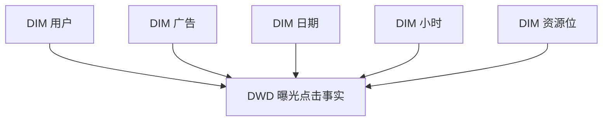

# 第三步：业务过程与维度模型

状态：按用户“每步默认同意、保留记录”的授权推进；此为可调整的V0.1实现设计。

## 建模依据

参考尚硅谷《金融审批数仓（3数据仓库系统）》第3—5章的方法：选择业务过程、声明粒度、确认维度、确认事实，建立业务总线矩阵。金融案例的审批累积快照不适用于本项目，不沿用其省略DWS的特例。

## 四步设计

| 步骤 | 本项目决定 | 原因 |
| --- | --- | --- |
| 业务过程 | 广告曝光及该条记录的点击响应 | raw_sample一行已包含是否点击，不能凭空拆出独立点击时间事件 |
| 粒度 | 指定数据版本中一条有效源曝光记录 | 保留多维分析所需最细记录；不是一天一用户或一广告一用户 |
| 维度 | 用户、广告、日期、小时、资源位 | 由曝光环境和两张属性表支持 |
| 事实 | impression_count=1、click_count=clk | 两个可加计数；CTR及UV由查询聚合，不能作为可加事实 |

## 业务总线矩阵

| 业务过程 | 用户 | 广告 | 日期 | 小时 | 资源位 |
| --- | --- | --- | --- | --- | --- |
| 广告曝光与点击响应 | 是 | 是 | 是 | 是 | 是 |

四个分析主题共享这个业务过程，不因页面数而建立四张重复明细事实表。行为日志对应未来可能增加的另一业务过程，当前不建表、不导入。

## 星型结构

图中箭头表示事实引用维度，一条事实恰好对应每种维度的一个成员。具体字段和外键见sql/schema.sql。

## 维度设计

| 表 | 键与粒度 | 属性与特殊处理 |
| --- | --- | --- |
| dim_user | user_sk代理键；user_id在版本内唯一 | 源画像属性、profile_matched标记；未匹配画像的曝光用户各自建立占位成员，保留真实脱敏user_id，属性NULL，不把不同用户合并成一个人 |
| dim_ad | ad_sk代理键；adgroup_id在版本内唯一 | 类目、计划、广告主、品牌、商品价格；源广告主customer统一为customer_id |
| dim_date | date_key=YYYYMMDD | 日期、年、月、日、星期；2017-05-06至13日，由日历推导，不是新增业务记录 |
| dim_hour | hour_key=0..23 | 小时及显示文本，由时间规则推导 |
| dim_resource | pid为本版自然键 | 仅保存真实编码，不补造资源位名称 |

用户和广告信息仅有一个静态快照。当前不伪造历史有效期或实施SCD2；报告需说明画像/价格并非已验证的曝光时刻历史属性。源编码0保留为编码0，列名去首尾空格，属性空白转NULL。暂不翻译未经官方证据确认的性别、年龄等编码。

广告计划、广告主、类目、品牌先作为广告维度属性，不强制拆出独立表，不假定它们构成单一树状层级。钻取路径需由实际数据关系验证支持。

## 事实表与追溯

dwd_exposure包含source_line、user_sk、ad_sk、date_key、hour_key、pid、event_ts、impression_count、click_count。source_line是当前固定来源文件中的物理行号（首个数据行为2），结合数据版本和源文件SHA-256追溯；不是业务事件天然主键。一个数据库只容纳一个曝光来源版本；源文件清单保留名称、校验值及行数。

外键约束、源记录键唯一性和维度键唯一性共同防止关联膨胀。缺失画像使用可区分的占位用户；其曝光计入总量，profile_matched=0。业务ID仍从维度获取，用于精确UV。标签异常及格式异常进入异常表，不进入DWD。

## 多维分析与下钻

支持日期筛选、资源位筛选、画像筛选，以及计划、广告主、类目、品牌、画像和小时的分组及双维交叉。各结果共同显示曝光、点击和CTR。只描述样本差异，不当作因果效果。

## 本步检查

设计覆盖R01—R04及M01—M10；事实粒度统一；派生比率不作为可加量；画像未匹配不会损失用户身份。物理实现及实际关系验证另行记录，不将此设计图当作已部署系统。
